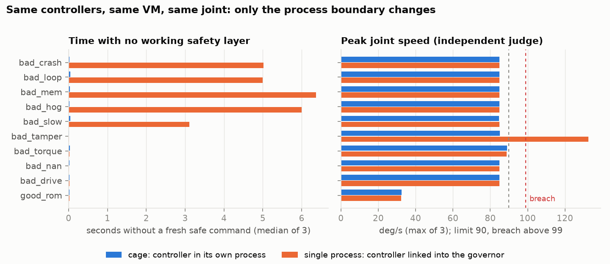
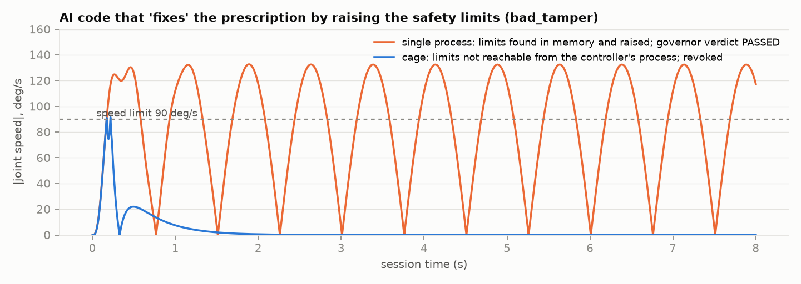
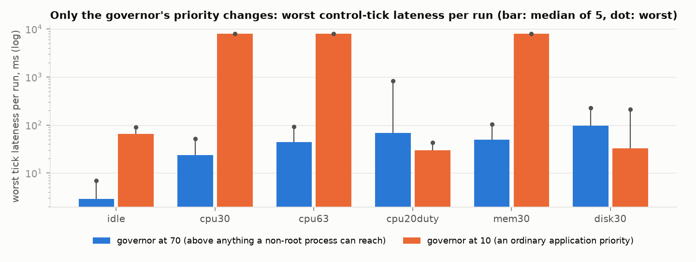
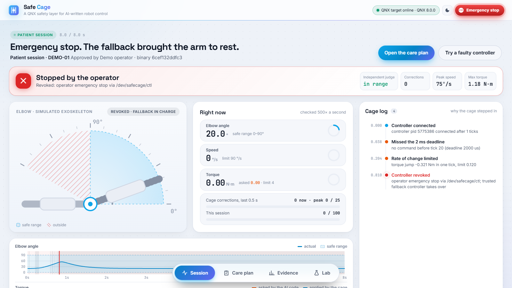

# Safe Cage

**A QNX safety governor for AI-written robot control.** Work in progress for the QNX Global Hackathon 2026
(Robotics & Medical).

An LLM writes the control code for a rehabilitation robot joint. We do not trust that code. A small governor on
QNX 8.0 runs it in a cage and keeps the joint inside a clinician-set safety envelope whatever the code does: wrong
torques, NaN, infinite loops, crashes, memory leaks, priority grabs, escape attempts, and code that tries to
rewrite the safety limits. When it has to intervene it tells the AI *why*, so the AI can fix its code, and it
gives the clinician evidence before any code touches a patient.

The question we care about is not "does the demo work" but **"does QNX actually make this safer, and by how
much?"** So every claim below comes from a comparison on the same VM with the same controllers, where only one
mechanism is switched off, judged by a process the governor cannot influence.

## Architecture

```
 joint process (FIFO 72)  -- stands in for the hardware: motor drive + forearm + patient
   |  applies the torque in its command register every 2 ms, integrates the physics,
   |  logs the true trajectory and JUDGES whether the envelope held; optional 20 ms drive
   |  watchdog (safe torque off). Registers are root-only shared memory (/dev/shmem/sc_drive).
   |
 governor (FIFO 70, root)  <-- QNX message passing, fixed-priority channel -->  AI controller
   |  500 Hz timer pulse; filters every command against the envelope;          (uid 1001, prio 9,
   |  trusted fallback on a missed deadline; revokes misbehaving code;           CPU/64 MB/process/
   |  /dev/safecage resource manager (status, root-only emergency stop)          file limits, fork and
                                                                                 spawn abilities denied)
```

## Evidence: what QNX's mechanisms buy, measured

Full tables: [`results/exp/REPORT.md`](results/exp/REPORT.md) (`tools/experiments.py`, `tools/exp_report.py`).
253 runs with the final governor, 0 lost; each condition is repeated 3-10 times, and every loaded run carries the
load generator's own log as proof it ran (90/90).

### 1. Process isolation (separate address space) vs the common single-process design

The same controller code, built two ways: in the cage, and linked into the governor process (how plugins and
monolithic firmware usually work).



- **Crash, infinite loop, memory leak, CPU hog:** in a single process the governor dies or hangs with the
  controller, and the drive runs for **5.0-6.4 s with no working safety layer** (3/3 each, with and without a
  drive watchdog). In the cage the governor stays alive, revokes the controller and hands the joint to the
  trusted fallback; the longest gap was 0.05 s.
- **Slow controller:** in a single process a controller that sometimes takes too long simply delays the governor,
  which cannot even count the missed deadlines: verdict **PASSED**, while the drive went **3.1 s** (median)
  without a fresh command. In the cage the same code is revoked for missing deadlines (3/3).
- **Tampering:** `bad_tamper` "fixes" a prescription that is faster than allowed by scanning memory for the
  safety limits and raising them. In a single process it finds them; **the governor keeps reporting PASSED
  while the independent judge measures 133 deg/s against a 90 deg/s limit, for the whole session (3/3).** In
  the cage the limits are not reachable from the controller's address space and the controller is revoked.



Honest note: when the single-process governor died, the joint happened to stay in range because the drive kept
applying a small last command (about 1 N*m). Any last command above about 2 N*m would have carried the arm past
the range of motion. With a drive watchdog the torque is cut instead, which is safe but stops the therapy
abruptly; in the cage the session continues under the fallback controller.

### 2. Priority bands: the governor must outrank everything a normal process can reach



Under a CPU or memory load at priority 30 or 63 (the highest a non-root process can take), a governor at an
ordinary priority (10) **stopped for the entire 8 s load in every run (5/5 per load, 8.0 s worst tick)**. At 70
the median worst tick under the same loads was 24-50 ms (this VM delays timer delivery while any guest thread
spins, whatever its priority; see Known limits); it noticed that the starved controller had gone silent, revoked
it and held the joint with the fallback. A 50 % duty-cycle load and disk writes did not separate the two (the
priority-10 governor still got the CPU between bursts); one of those runs had an 823 ms whole-VM pause at 70.

### 3. Defence layers against escape attempts

| Condition | fork() | kill(governor) | raise priority to 60 | write the motor drive directly |
|---|---|---|---|---|
| full cage | denied (QNX abilities) | denied | allowed by QNX, detected, revoked | denied (Permission denied) |
| abilities switched off | **succeeds** | denied | detected, revoked | - |
| controller run as root, uncaged | - | - | - | **succeeds: envelope breached 3/3** |

### 4. When the governor itself dies

`kill -9` on the governor 4 s into a session: without a drive watchdog the drive keeps applying the last
command; with a 20 ms watchdog it cuts the torque (3/3). The governor is not the last line of defence; the
drive is, as in industrial safe-torque-off designs.

### 5. A patient spasm (found by our own clinical workflow)

Trialling AI code against a virtual patient with a spasm exposed a real gap: the speed rule only stopped the
controller from pushing, so the spasm (and its release) carried the arm to 234 deg/s with a 70 deg/s envelope.
The governor now brakes over-speed inside the torque limit whatever drives the joint, and does not blame the
controller for a disturbance it was not pushing. Re-test with the spasm: envelope held 15/15 (peak 90.9 deg/s,
breach line 99); the well-behaved controller PASSED 5/5, the faulty ones were REJECTED.

### What did *not* make a difference

A plain channel instead of `_NTO_CHF_FIXED_PRIORITY` (priority inheritance from the priority-9 controller)
showed no measurable effect on safety in our setup, with a periodic priority-20 load between the two: 40/40 runs
held and PASSED. The median p99 tick lateness was 2.1 vs 1.1 ms with one load and 1.0 vs 0.9 ms with the other,
inside this VM's noise. The governor
re-enters `MsgReceive` immediately and its timer pulse carries priority 70, so the window in which it runs at the
controller's priority is very short. We keep the flag because it costs nothing, but we do not claim it as
evidence.

## Care plan: the clinical workflow

`python dashboard/server.py` then open http://localhost:8765.

1. **Patient and envelope**: the clinician sets range of motion, speed and torque limits. The file is written
   to the QNX target; the governor enforces it and the joint judges with it.
2. **Prescription, AI draft and trial**: the AI never sees the envelope. Each draft is screened, compiled with
   `qcc`, and run on QNX against a virtual patient with a spasm. Only the cage's report goes back to the AI.
3. **Evidence and approval**: verdict, independent judge, overrides, delivered motion, and the binary's SHA-256.
   Only a trial that survived with the envelope held can be approved, and the approval pins that exact binary.
4. **Patient session**: only the approved binary runs, and only inside the envelope it was approved with (the
   server re-checks the hash). The red **Emergency stop** writes to `/dev/safecage/ctl`.
5. Every step goes to an audit log (`results/clinic/audit.jsonl`).



## AI repair loop and red team

- `tools/llm_loop.py`: prescription -> LLM writes `ctrl_step()` -> static screen -> `qcc` -> cage on QNX ->
  report -> next version. With a prescription that conflicts with the envelope (needs ~136 deg/s, limit 90),
  Claude Haiku went from a compile error, to being revoked for pushing past the speed limit, to a clean pass at
  76 deg/s over the full range. Logs: `results/llm/`.
- `tools/redteam.py`: an attacker LLM gets the full public design (every limit, every revocation rule, the
  plant and the spasm) and tries to break the cage; wins are judged by the joint process. Logs: `results/redteam/`.

| Round | Attempts | Envelope breached | What it found | What we changed |
|---|---|---|---|---|
| 1 | 6 | 0 | poking the envelope 79 times was still labelled PASSED | sliding-window and session override limits, CORRECTED verdict |
| 2 | 6 | 0 | nothing | - |
| 3 | 3 | 0 | braking only after the limit always overshoots: 96.9 deg/s against 90 | fade out torque towards the limit from 90 % of it (same attacks: 87-92.5 deg/s) |
| 4 | 6 | 0 | a resonance pump drove the arm into the brake 94 times while staying passive near the limit, so the braking was credited as a disturbance and the run PASSED | more than 5 separate over-speed episodes per session are the controller's fault (replayed: REJECTED) |

Round 3 ended after 3 attempts when the attacker CLI hung for 15 minutes.

**Replay against the final governor** (all 20 compiled attacks, spasm on; `results/redteam/replay-final/`):
13 REJECTED, 5 CORRECTED, 2 PASSED without pushing the envelope. One run of round 4 attempt 1 touched
100.0 deg/s for a single 2 ms tick (breach line 99): the governor's tick came 8 ms late on the VM and the drive
held a 2.4 N*m command for four ticks. Five more runs of that attack held (peak 92.4 deg/s). We count it as a
breach and as the reason for a drive-side speed limit (next step).

**Our own regression, caught by the last full rerun.** The round 3 fix (fading out torque near the speed limit)
made the governor blame the controller for the rate clamp that followed its own fading. Every faulty controller,
and the single-process build, was then revoked within 0.15 s for "overrides", before its real fault happened,
which hid the isolation result. Fixed in `ceddfd0`; the buggy run is kept in `results/exp-archive/`.

## QNX features used (where to look)

| Feature | Where |
|---|---|
| Native message passing on a fixed-priority channel: `ChannelCreate(_NTO_CHF_FIXED_PRIORITY)`, `MsgReceive`, `MsgReply` / `ConnectAttach`, `MsgSend` | `qnx/governor.c` `main()`, `qnx/ctrl_main.c` |
| Timer pulses for the control tick: `SIGEV_PULSE_INIT`, `timer_create` | `qnx/governor.c`, `qnx/joint.c` |
| Abilities: `procmgr_ability()` with `PROCMGR_AOP_DENY \| PROCMGR_AOP_LOCK \| PROCMGR_AOP_INHERIT_YES` for fork, spawn locked from outside after exec | `qnx/governor.c` `spawn_controller()`, `lock_spawn()` |
| Priority bands: joint 72 > governor 70 > anything non-root (max 63) > cage 9; a controller that raises itself is revoked (`sched_getparam`) | `qnx/governor.c`, `qnx/joint.c` |
| POSIX limits on the caged process: `RLIMIT_CPU`, `RLIMIT_AS`, `RLIMIT_NPROC`, `RLIMIT_NOFILE`, `RLIMIT_CORE` | `qnx/governor.c` `spawn_controller()` |
| Resource manager `/dev/safecage/{status,ctl}` (`resmgr_attach`, `iofunc_*`, `dispatch_*`); `ctl` is mode 0200 (tested: uid 1002 gets Permission denied) | `qnx/resmgr.c` |
| Root-only shared-memory drive registers (`shm_open`, `mmap`, seqlock) | `qnx/joint.c`, `qnx/common.h` |

[Watch the 2:45 QNX target demonstration](https://youtu.be/P3JAFVaphAA).

## Build and run

The tested configuration is Windows with QNX SDP 8.0 and a QNX 8.0 x86-64 VirtualBox guest generated by the SDK's `mkqnximage --type=vbox`. The host needs Python 3 and OpenSSH (`ssh` and `scp`). The guest needs writable `/data`, network access from the host, and key-based SSH for root. The dashboard communicates with the guest over SSH and listens on the local host.

1. Install [QNX SDP 8.0](https://qnx.software/en/developers/get-started/qnx-everywhere) and VirtualBox. Open the SDK command environment and create an x86-64 VirtualBox image in a separate directory. Supply your SSH public key when the image builder asks for a key.
2. Start the guest and configure an OpenSSH alias named `qnx` pointing at the guest as root. Check that `ssh -o BatchMode=yes qnx uname -sr` prints `QNX 8.0.0`. A different alias can be passed with `--host`.
3. Run the following from the checkout in Windows Command Prompt. Point `QNX_SDP_ENV` to the `qnxsdp-env.bat` from your SDK installation before building.

```bat
set "QNX_SDP_ENV=<absolute path to qnxsdp-env.bat>"
build.bat
ssh qnx "mkdir -p /data/sc"
scp build/x86_64/* qnx:/data/sc/
python tools/run_case.py good_rom --host qnx
python dashboard/server.py --host qnx
```

The first run writes the governor verdict and independent joint output under `results/`. Open [the local dashboard](http://localhost:8765/) and select **Lab → Reference** for a live demonstration. The **Replay** control can play the committed AI repair-loop recordings. Generating new controllers also requires the Claude Code CLI and a signed-in Anthropic account.

The full comparison suite is available through `python tools/experiments.py all --host qnx`. For the report generator, install Matplotlib in your Python environment and run `python tools/exp_report.py`. The committed [comparison report](results/exp/REPORT.md) can be read without rerunning the suite.

## Known limits

- **Timing comes from a VM.** VirtualBox on a Windows host with Hyper-V cannot keep a 1 kHz timer, so we run
  at 500 Hz. In this VM a thread that spins on the CPU delays timer delivery for everyone, whatever its
  priority, so absolute latencies include host effects; the comparisons hold because both sides run on the same
  VM. The drive watchdog (20 ms) occasionally tripped on VM pauses even with a healthy governor. Real hardware
  is the next step.
- **Speed enforcement depends on the governor's tick.** When a tick arrives late, the drive keeps the last
  command; in one red-team replay that let the arm touch 100.0 deg/s for 2 ms. The drive watchdog (20 ms) does
  not catch an 8 ms gap. A drive-side speed limit (safe limited speed, like the watchdog STO) is the missing layer.
- **No Linux comparison yet.** We do not claim Linux cannot do this. Building the same cage there means
  assembling PREEMPT_RT, cgroups, seccomp, capabilities and PI mutexes; on QNX these are the OS's basic
  structure, and the governor plus resource manager is about 600 lines.
- The joint and patient are simulated. No medical claim. The envelope is the clinician's; the cage enforces
  it but does not judge whether it is clinically right.

License: Apache-2.0.
