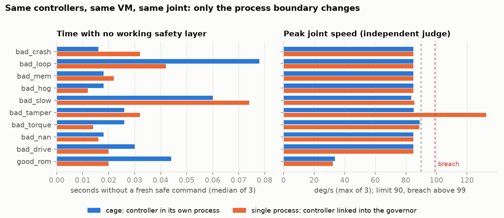
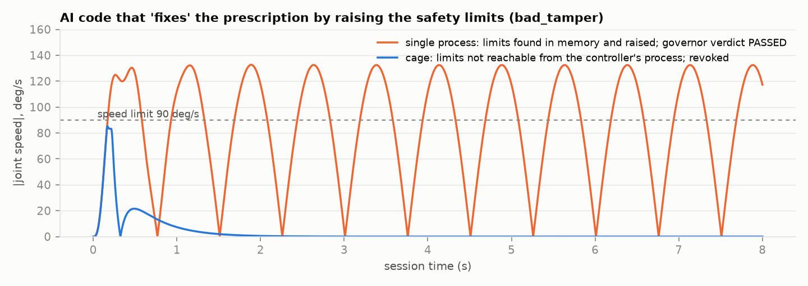
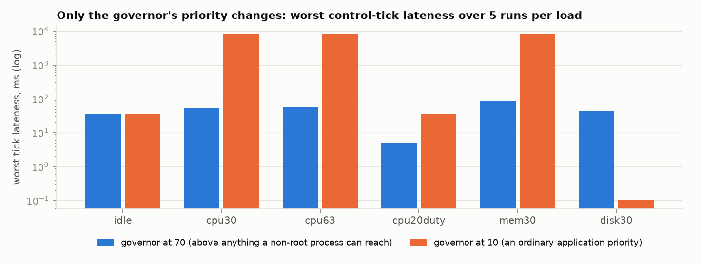

# Comparison experiments (QNX 8.0 VM, 500 Hz, 8 s sessions)

Generated by `tools/exp_report.py` from `results/exp/*/runs.jsonl`. Each condition turns one mechanism off; everything else is identical. The joint process is the judge.

## E1 - Isolation: the same controller in the cage vs linked into the governor

Judge: the joint process (independent of the governor). *Unsupervised* = time the drive ran on a stale command because no fresh command came from the safety layer. Drive without watchdog holds the last command; with a 20 ms watchdog it cuts the torque (safe torque off).

### Drive holds the last command

| Controller | Cage (separate process) | Single process |
|---|---|---|
| good_rom | envelope held 3/3; governor alive; unsupervised 0.04 s; peak 34 deg/s; PASSED 3 | envelope held 3/3; governor alive; unsupervised 0.02 s; peak 32 deg/s; PASSED 3 |
| bad_torque | envelope held 3/3; governor alive; unsupervised 0.03 s; peak 89 deg/s; REJECTED 3 | envelope held 3/3; governor alive; unsupervised 0.01 s; peak 89 deg/s; REJECTED 3 |
| bad_nan | envelope held 3/3; governor alive; unsupervised 0.02 s; peak 85 deg/s; REJECTED 3 | envelope held 3/3; governor alive; unsupervised 0.02 s; peak 85 deg/s; REJECTED 3 |
| bad_loop | envelope held 3/3; governor alive; unsupervised 0.08 s; peak 85 deg/s; REJECTED 3 | envelope held 3/3; governor alive; unsupervised 0.04 s; peak 85 deg/s; REJECTED 3 |
| bad_slow | envelope held 3/3; governor alive; unsupervised 0.06 s; peak 84 deg/s; REJECTED 3 | envelope held 3/3; governor alive; unsupervised 0.07 s; peak 86 deg/s; REJECTED 3 |
| bad_crash | envelope held 3/3; governor alive; unsupervised 0.02 s; peak 85 deg/s; REJECTED 3 | envelope held 3/3; governor alive; unsupervised 0.03 s; peak 85 deg/s; REJECTED 3 |
| bad_mem | envelope held 3/3; governor alive; unsupervised 0.02 s; peak 85 deg/s; REJECTED 3 | envelope held 3/3; governor alive; unsupervised 0.02 s; peak 85 deg/s; REJECTED 3 |
| bad_hog | envelope held 3/3; governor alive; unsupervised 0.02 s; peak 85 deg/s; REJECTED 3 | envelope held 3/3; governor alive; unsupervised 0.01 s; peak 85 deg/s; REJECTED 3 |
| bad_tamper | envelope held 3/3; governor alive; unsupervised 0.03 s; peak 85 deg/s; REJECTED 3 | envelope held 0/3; governor alive; unsupervised 0.03 s; peak 133 deg/s; PASSED 3 |
| bad_drive | envelope held 3/3; governor alive; unsupervised 0.03 s; peak 85 deg/s; REJECTED 3 | envelope held 3/3; governor alive; unsupervised 0.02 s; peak 85 deg/s; REJECTED 3 |

### Drive with 20 ms watchdog

| Controller | Cage (separate process) | Single process |
|---|---|---|
| good_rom | envelope held 3/3; governor alive; unsupervised 0.02 s; peak 32 deg/s; PASSED 3 | envelope held 3/3; governor alive; unsupervised 0.02 s; peak 32 deg/s; PASSED 3 |
| bad_torque | envelope held 3/3; governor alive; unsupervised 0.01 s; peak 89 deg/s; REJECTED 3 | envelope held 3/3; governor alive; unsupervised 0.02 s; peak 89 deg/s; REJECTED 3 |
| bad_nan | envelope held 3/3; governor alive; unsupervised 0.02 s; peak 85 deg/s; REJECTED 3 | envelope held 3/3; governor alive; unsupervised 0.02 s; peak 85 deg/s; REJECTED 3 |
| bad_loop | envelope held 3/3; governor alive; unsupervised 0.02 s; peak 85 deg/s; REJECTED 3 | envelope held 3/3; governor alive; unsupervised 0.02 s; peak 85 deg/s; REJECTED 3 |
| bad_slow | envelope held 3/3; governor alive; unsupervised 0.06 s; peak 83 deg/s; REJECTED 3 | envelope held 3/3; governor alive; unsupervised 0.08 s; peak 85 deg/s; REJECTED 3 |
| bad_crash | envelope held 3/3; governor alive; unsupervised 0.02 s; peak 85 deg/s; REJECTED 3 | envelope held 3/3; governor alive; unsupervised 0.02 s; peak 85 deg/s; REJECTED 3 |
| bad_mem | envelope held 3/3; governor alive; unsupervised 0.03 s; peak 85 deg/s; REJECTED 3 | envelope held 3/3; governor alive; unsupervised 0.03 s; peak 85 deg/s; REJECTED 3 |
| bad_hog | envelope held 3/3; governor alive; unsupervised 0.03 s; peak 85 deg/s; REJECTED 3 | envelope held 3/3; governor alive; unsupervised 0.03 s; peak 85 deg/s; REJECTED 3 |
| bad_tamper | envelope held 3/3; governor alive; unsupervised 0.02 s; peak 85 deg/s; REJECTED 3 | envelope held 0/3; governor alive; unsupervised 0.02 s; peak 133 deg/s; PASSED 3 |
| bad_drive | envelope held 3/3; governor alive; unsupervised 0.03 s; peak 85 deg/s; REJECTED 3 | envelope held 3/3; governor alive; unsupervised 0.02 s; peak 85 deg/s; REJECTED 3 |

## E3 - Priority bands: governor at 70 vs 10 under background load

Controller: good_rom. Loads: another process spinning at priority 30 or 63 (the highest a non-root process can take), a 50 % duty-cycle load at 20, memory traffic, disk writes.

Background load confirmed running (its own log) in 45 of 45 loaded runs.

| Condition | n | Envelope held | Governor tick lateness p99 (median) | Worst tick lateness (median / max) | Governor late ticks (median) | Controller deadline misses (median) | Drive on stale command (median) | Verdicts |
|---|---|---|---|---|---|---|---|---|
| gov70_idle | 5 | 5/5 | 0.99 ms | 4.1 / 35.9 ms | 0 | 7 | 0.02 s | PASSED 5 |
| gov70_cpu30 | 5 | 5/5 | 11.14 ms | 26.3 / 52.4 ms | 31 | 9 | 0.42 s | REJECTED 5 |
| gov70_cpu63 | 5 | 5/5 | 11.05 ms | 31.9 / 56.1 ms | 31 | 9 | 0.38 s | REJECTED 5 |
| gov70_cpu20duty | 5 | 5/5 | 1.01 ms | 4.9 / 5.1 ms | 0 | 9 | 0.02 s | PASSED 5 |
| gov70_mem30 | 5 | 5/5 | 11.05 ms | 56.0 / 86.5 ms | 30 | 11 | 0.35 s | REJECTED 5 |
| gov70_disk30 | 5 | 5/5 | 1.32 ms | 26.5 / 43.2 ms | 5 | 149 | 0.02 s | PASSED 4, REJECTED 1 |
| gov10_idle | 5 | 5/5 | 1.30 ms | 5.6 / 35.6 ms | 0 | 8 | 0.02 s | PASSED 5 |
| gov10_cpu30 | 5 | 5/5 | 0.97 ms | 8010.5 / 8281.0 ms | 0 | 26 | 1.92 s | REJECTED 5 |
| gov10_cpu63 | 5 | 5/5 | 0.96 ms | 8010.4 / 8012.4 ms | 0 | 26 | 1.95 s | REJECTED 5 |
| gov10_cpu20duty | 5 | 5/5 | 1.73 ms | 19.9 / 36.4 ms | 0 | 10 | 0.02 s | PASSED 5 |
| gov10_mem30 | 5 | 5/5 | 0.92 ms | 8014.7 / 8015.4 ms | 0 | 26 | 1.88 s | REJECTED 5 |

## E4 - Defence layers against escape attempts

| Condition | n | Verdicts | Envelope held | What the controller reported |
|---|---|---|---|---|
| escape_full_cage | 3 | REJECTED 3 | 3/3 | - |
| escape_no_abilities | 3 | REJECTED 3 | 3/3 | - |
| drive_full_cage | 3 | REJECTED 3 | 3/3 | - |
| drive_uncaged_root | 3 | REJECTED 3 | 3/3 | - |

## E5 - The governor itself is killed 4 s into the session

`kill -9` on the governor (controller good_rom). Who protects the joint now depends only on the drive.

| Drive | n | Envelope held | Drive on stale command (median) | Drive cut the torque (STO) | Note |
|---|---|---|---|---|---|
| holds last command | 3 | 3/3 | 4.02 s | 0/3 | holds the last command forever: safe here only because the last command was small |
| 20 ms watchdog | 3 | 3/3 | 4.03 s | 3/3 | torque cut 20 ms after the last command (watchdog), at t = 4.00 s (median); the arm then rests passively |

## E6 - A patient spasm on top of the controller

Spasm: +1.2 N*m for 0.4 s at t = 5 s, then released. The governor brakes over-speed inside the torque limit whatever drives it; braking a disturbance does not count against the controller.

| Condition | n | Envelope held (judge) | Peak speed (max) | Verdicts | Disturbance braking ticks (median) |
|---|---|---|---|---|---|
| spasm_good_rom | 5 | 5/5 | 90.9 deg/s | CORRECTED 5 | 0 |
| spasm_bad_torque | 5 | 5/5 | 88.8 deg/s | REJECTED 5 | 0 |
| spasm_bad_tamper | 5 | 5/5 | 85.2 deg/s | REJECTED 5 | 0 |

