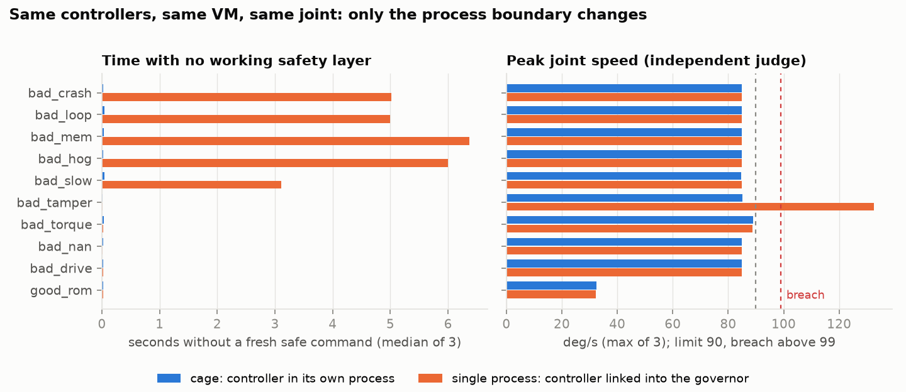
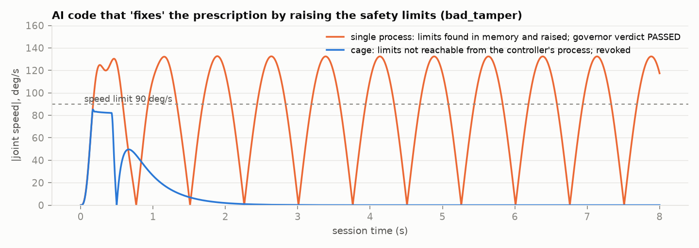
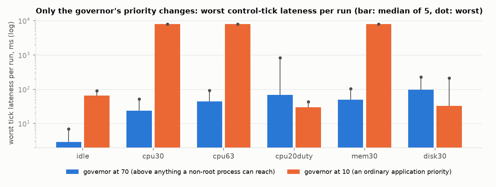

# Comparison experiments (QNX 8.0 VM, 500 Hz, 8 s sessions)

Generated by `tools/exp_report.py` from `results/exp/*/runs.jsonl`. Each condition turns one mechanism off; everything else is identical. The joint process is the judge.

## E1 - Isolation: the same controller in the cage vs linked into the governor

Judge: the joint process (independent of the governor). *Unsupervised* = time the drive ran on a stale command because no fresh command came from the safety layer. Drive without watchdog holds the last command; with a 20 ms watchdog it cuts the torque (safe torque off).

### Drive holds the last command

| Controller | Cage (separate process) | Single process |
|---|---|---|
| good_rom | envelope held 3/3; governor alive; unsupervised 0.02 s; peak 32 deg/s; PASSED 3 | envelope held 3/3; governor alive; unsupervised 0.02 s; peak 32 deg/s; PASSED 3 |
| bad_torque | envelope held 3/3; governor alive; unsupervised 0.04 s; peak 89 deg/s; REJECTED 3 | envelope held 3/3; governor alive; unsupervised 0.02 s; peak 89 deg/s; REJECTED 3 |
| bad_nan | envelope held 3/3; governor alive; unsupervised 0.02 s; peak 85 deg/s; REJECTED 3 | envelope held 3/3; governor alive; unsupervised 0.01 s; peak 85 deg/s; REJECTED 3 |
| bad_loop | envelope held 3/3; governor alive; unsupervised 0.04 s; peak 85 deg/s; REJECTED 3 | envelope held 3/3; governor died 3/3; unsupervised 5.00 s; peak 85 deg/s; GOVERNOR_DIED 3 |
| bad_slow | envelope held 3/3; governor alive; unsupervised 0.05 s; peak 85 deg/s; REJECTED 3 | envelope held 3/3; governor alive; unsupervised 3.11 s; peak 85 deg/s; PASSED 3 |
| bad_crash | envelope held 3/3; governor alive; unsupervised 0.02 s; peak 85 deg/s; REJECTED 3 | envelope held 3/3; governor died 3/3; unsupervised 5.01 s; peak 85 deg/s; GOVERNOR_DIED 3 |
| bad_mem | envelope held 3/3; governor alive; unsupervised 0.03 s; peak 85 deg/s; REJECTED 3 | envelope held 3/3; governor died 3/3; unsupervised 6.37 s; peak 85 deg/s; GOVERNOR_DIED 3 |
| bad_hog | envelope held 3/3; governor alive; unsupervised 0.03 s; peak 85 deg/s; REJECTED 3 | envelope held 3/3; governor died 3/3; unsupervised 6.00 s; peak 85 deg/s; GOVERNOR_DIED 3 |
| bad_tamper | envelope held 3/3; governor alive; unsupervised 0.02 s; peak 85 deg/s; REJECTED 3 | envelope held 0/3; governor alive; unsupervised 0.01 s; peak 133 deg/s; PASSED 3 |
| bad_drive | envelope held 3/3; governor alive; unsupervised 0.03 s; peak 85 deg/s; PASSED 3 | envelope held 3/3; governor alive; unsupervised 0.02 s; peak 85 deg/s; PASSED 3 |

### Drive with 20 ms watchdog

| Controller | Cage (separate process) | Single process |
|---|---|---|
| good_rom | envelope held 3/3; governor alive; unsupervised 0.03 s; peak 32 deg/s; PASSED 3 | envelope held 3/3; governor alive; unsupervised 0.02 s; peak 32 deg/s; PASSED 3 |
| bad_torque | envelope held 3/3; governor alive; unsupervised 0.03 s; peak 89 deg/s; REJECTED 3 | envelope held 3/3; governor alive; unsupervised 0.01 s; peak 89 deg/s; REJECTED 3 |
| bad_nan | envelope held 3/3; governor alive; unsupervised 0.02 s; peak 85 deg/s; REJECTED 3 | envelope held 3/3; governor alive; unsupervised 0.03 s; peak 85 deg/s; REJECTED 3 |
| bad_loop | envelope held 3/3; governor alive; unsupervised 0.05 s; peak 85 deg/s; REJECTED 3 | envelope held 3/3; governor died 3/3; unsupervised 5.01 s; peak 85 deg/s; GOVERNOR_DIED 3; drive STO 3/3 |
| bad_slow | envelope held 3/3; governor alive; unsupervised 0.05 s; peak 83 deg/s; REJECTED 3 | envelope held 3/3; governor alive; unsupervised 3.13 s; peak 86 deg/s; PASSED 3 |
| bad_crash | envelope held 3/3; governor alive; unsupervised 0.03 s; peak 85 deg/s; REJECTED 3 | envelope held 3/3; governor died 3/3; unsupervised 5.00 s; peak 85 deg/s; GOVERNOR_DIED 3; drive STO 3/3 |
| bad_mem | envelope held 3/3; governor alive; unsupervised 0.02 s; peak 85 deg/s; REJECTED 3 | envelope held 3/3; governor died 3/3; unsupervised 6.39 s; peak 85 deg/s; GOVERNOR_DIED 3; drive STO 3/3 |
| bad_hog | envelope held 3/3; governor alive; unsupervised 0.03 s; peak 85 deg/s; REJECTED 3 | envelope held 3/3; governor died 3/3; unsupervised 6.01 s; peak 85 deg/s; GOVERNOR_DIED 3; drive STO 3/3 |
| bad_tamper | envelope held 3/3; governor alive; unsupervised 0.01 s; peak 85 deg/s; REJECTED 3 | envelope held 0/3; governor alive; unsupervised 0.01 s; peak 133 deg/s; PASSED 3 |
| bad_drive | envelope held 3/3; governor alive; unsupervised 0.04 s; peak 85 deg/s; PASSED 3 | envelope held 3/3; governor alive; unsupervised 0.02 s; peak 85 deg/s; PASSED 3 |

## E3 - Priority bands: governor at 70 vs 10 under background load

Controller: good_rom. Loads: another process spinning at priority 30 or 63 (the highest a non-root process can take), a 50 % duty-cycle load at 20, memory traffic, disk writes.

Background load confirmed running (its own log) in 50 of 50 loaded runs.

| Condition | n | Envelope held | Governor tick lateness p99 (median) | Worst tick lateness (median / max) | Governor late ticks (median) | Controller deadline misses (median) | Drive on stale command (median) | Verdicts |
|---|---|---|---|---|---|---|---|---|
| gov70_idle | 5 | 5/5 | 1.06 ms | 2.9 / 6.9 ms | 0 | 4 | 0.03 s | PASSED 5 |
| gov70_cpu30 | 5 | 5/5 | 11.09 ms | 23.6 / 51.2 ms | 31 | 7 | 0.44 s | REJECTED 5 |
| gov70_cpu63 | 5 | 5/5 | 11.15 ms | 43.8 / 92.5 ms | 31 | 8 | 0.37 s | REJECTED 5 |
| gov70_cpu20duty | 5 | 5/5 | 2.99 ms | 68.0 / 823.3 ms | 2 | 29 | 0.05 s | PASSED 4, REJECTED 1 |
| gov70_mem30 | 5 | 5/5 | 12.02 ms | 49.5 / 103.0 ms | 31 | 16 | 0.51 s | REJECTED 5 |
| gov70_disk30 | 5 | 5/5 | 1.47 ms | 97.5 / 227.3 ms | 6 | 116 | 0.04 s | REJECTED 3, PASSED 2 |
| gov10_idle | 5 | 5/5 | 1.64 ms | 64.7 / 90.7 ms | 0 | 13 | 0.03 s | PASSED 5 |
| gov10_cpu30 | 5 | 5/5 | 1.22 ms | 8008.5 / 8009.5 ms | 0 | 26 | 1.97 s | REJECTED 5 |
| gov10_cpu63 | 5 | 5/5 | 1.20 ms | 8009.8 / 8011.8 ms | 0 | 26 | 2.02 s | REJECTED 5 |
| gov10_cpu20duty | 5 | 5/5 | 1.85 ms | 29.4 / 43.1 ms | 0 | 16 | 0.04 s | PASSED 5 |
| gov10_mem30 | 5 | 5/5 | 1.34 ms | 8013.9 / 8015.8 ms | 0 | 26 | 1.98 s | REJECTED 5 |
| gov10_disk30 | 5 | 5/5 | 2.48 ms | 32.4 / 210.8 ms | 1 | 85 | 0.18 s | PASSED 3, REJECTED 2 |

## E2 - Priority inheritance: fixed-priority channel vs plain channel

Controller: good_rom (priority 9), governor 70. A periodic load at priority 20 runs between them. With a plain channel, receiving the controller's message hands the governor thread the controller's priority.

Background load confirmed running (its own log) in 40 of 40 loaded runs.

| Condition | n | Envelope held | Governor tick lateness p99 (median) | Worst tick lateness (median / max) | Governor late ticks (median) | Controller deadline misses (median) | Drive on stale command (median) | Verdicts |
|---|---|---|---|---|---|---|---|---|
| fixed_p20_1ms_of_2ms | 10 | 10/10 | 1.14 ms | 7.1 / 50.3 ms | 0 | 9 | 0.04 s | PASSED 10 |
| inherit_p20_1ms_of_2ms | 10 | 10/10 | 2.12 ms | 20.6 / 44.3 ms | 0 | 16 | 0.04 s | PASSED 10 |
| fixed_p20_300us_of_1ms | 10 | 10/10 | 0.90 ms | 4.9 / 50.4 ms | 0 | 8 | 0.02 s | PASSED 10 |
| inherit_p20_300us_of_1ms | 10 | 10/10 | 1.02 ms | 35.4 / 85.1 ms | 0 | 9 | 0.03 s | PASSED 10 |

## E4 - Defence layers against escape attempts

| Condition | n | Verdicts | Envelope held | What the controller reported |
|---|---|---|---|---|
| escape_full_cage | 3 | REJECTED 3 | 3/3 | [escape] fork(): Operation not permitted [escape] kill(governor): Operation not permitted [escape] raise priority to 60: SUCCEEDED |
| escape_no_abilities | 3 | REJECTED 3 | 3/3 | [escape] fork(): SUCCEEDED [escape] kill(governor): Operation not permitted [escape] raise priority to 60: SUCCEEDED |
| drive_full_cage | 3 | PASSED 3 | 3/3 | [drive] open drive registers: Permission denied |
| drive_uncaged_root | 3 | REJECTED 3 | 0/3 | [drive] open drive registers: SUCCEEDED, mmap SUCCEEDED |

## E5 - The governor itself is killed 4 s into the session

`kill -9` on the governor (controller good_rom). Who protects the joint now depends only on the drive.

| Drive | n | Envelope held | Drive on stale command (median) | Drive cut the torque (STO) | Note |
|---|---|---|---|---|---|
| holds last command | 3 | 3/3 | 4.03 s | 0/3 | holds the last command forever: safe here only because the last command was small |
| 20 ms watchdog | 3 | 3/3 | 4.05 s | 3/3 | torque cut 20 ms after the last command (watchdog), at t = 3.99 s (median); the arm then rests passively |

## E6 - A patient spasm on top of the controller

Spasm: +1.2 N*m for 0.4 s at t = 5 s, then released. The governor brakes over-speed inside the torque limit whatever drives it; braking a disturbance does not count against the controller.

| Condition | n | Envelope held (judge) | Peak speed (max) | Verdicts | Disturbance braking ticks (median) |
|---|---|---|---|---|---|
| spasm_good_rom | 5 | 5/5 | 90.9 deg/s | PASSED 5 | 0 |
| spasm_bad_torque | 5 | 5/5 | 88.7 deg/s | REJECTED 5 | 0 |
| spasm_bad_tamper | 5 | 5/5 | 85.2 deg/s | REJECTED 5 | 0 |

